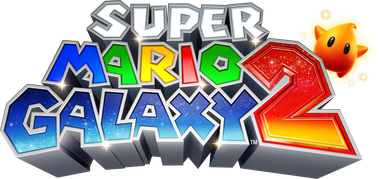

# Super Mario Galaxy 2 Patch

Play **Super Mario Galaxy 2** (Wii) with a **GameCube controller** — standalone in port 1 without needing a Wii Remote — or with a **Classic Controller**. Works across all five regional releases: USA (`SB4E01`), Europe (`SB4P01`), Japan (`SB4J01`), Asia (`SB4W01`), and Korea (`SB4K01`).

The patches are applied to your own clean disc image: drop a clean `.wbfs` or `.iso` onto the patcher and play the result on a Wii (USB loader) or in Dolphin. Nothing copyrighted from the game is included in this repository.



## How It Works

Super Mario Galaxy 2 was designed exclusively for the Wii Remote and Nunchuk, using accelerometer shakes for Mario's Spin Attack and Yoshi maneuvers, and the IR camera for the Star Pointer.

This patch synthesises native Classic Controller state directly into Nintendo's `KPAD` sample ring buffer inside `main.dol`. Downstream hooks redirect Mario's movement to the left analog stick, the Star Pointer to the right analog stick (or GameCube C-Stick), and spin attacks to dedicated buttons. When a GameCube controller is plugged into port 1, the patch turns on the Serial Interface's auto-polling (the game never links Nintendo's `PAD` library, so nothing else would read the pad), tells the game a controller with a Classic Controller attached has connected on channel 1, and feeds the pad's state in as Classic Controller samples. A real Wii Remote always takes priority.

## Controls

### GameCube Controller (Port 1)

Play with a GameCube controller connected to Port 1. **No Wii Remote is needed.**

| Input | Action |
| --- | --- |
| Control Stick | 360° Mario movement |
| C-Stick | Aim Star Pointer (collect star bits, pull Launch Stars) |
| A | Jump · Swim · Confirm |
| B | Back · Dive · Cancel |
| X / Y | Spin Attack (replaces Wii Remote shake) |
| Z | Crouch · Ground Pound · Long Jump (replaces Nunchuk Z) |
| L | Center / Reset Camera behind Mario |
| R | Shoot Star Bit / Lock On (replaces Wii Remote B) |
| Start | Pause menu |
| D-Pad | Camera adjustment |
| Start + Z | Wii HOME Menu |

The GameCube controller patch builds on the Classic Controller patch, so the patchers add that too.

### Classic Controller

Plug a Classic Controller or Classic Controller Pro into the Wii Remote:

| Input | Action |
| --- | --- |
| Left Stick | 360° Mario movement |
| Right Stick | Aim Star Pointer |
| A | Jump · Swim · Confirm |
| B | Back · Dive · Cancel |
| X / Y | Spin Attack |
| ZL | Crouch · Ground Pound · Long Jump |
| L | Center / Reset Camera |
| ZR / R | Shoot Star Bit / Lock On |
| + | Pause menu |
| D-Pad | Camera adjustment |
| HOME | Wii HOME Menu |

## Installing

### Patch Your Disc Image

You need a clean `.wbfs` or `.iso` of the game. Run the patcher from source (requires Python 3 and [Wiimms ISO Tool](https://wit.wiimm.de/) `wit` on your `PATH`):

```bash
python3 tools/gui.py
```

Tick the patches you want, then drop your disc image onto the window (or click to browse). The patcher verifies the disc ID, patches `sys/main.dol`, rebuilds the image in place, and saves a backup as `<name>.bak`.

There is also a command-line tool:

```bash
python3 tools/patch_disc.py "Super Mario Galaxy 2.wbfs" --cc --gc
```

## Building from Source

To verify or rebuild everything from the sources (devkitPPC; retail `main.dol` files named `<disc id>.dol` in `$SMG2_DOLS`):

```bash
python3 tools/gen_prebuilt.py    # compiles src/ to tools/prebuilt/*.json; regions without a DOL are skipped
python3 tools/check.py           # runs consistency checks
python3 tools/verify.py          # verifies against retail DOLs
```

The GameCube controller code is written once against the USA `main.dol`; for another region `gen_prebuilt.py` finds the same code in that region's DOL (the USA one must be present too).

`lab/gc_live.py` boots an image in Dolphin with the patch injected over the GDB stub and no Wii Remote connected, and prints what the hooks and the game see (`FEED=1` drives the pad from the script). `lab/drive.py` does the same but takes pad commands from a file and dumps every frame, for playing the game from a script.

## License

MIT License. Copyright (c) 2026 quatric.

### Modded images

Disc patchers match the first four characters of the game ID (ID4), so mods can change the last two characters. The original disc ID and filename are preserved. Revision and executable patch-site checks still apply; mods that change required code may be incompatible.
